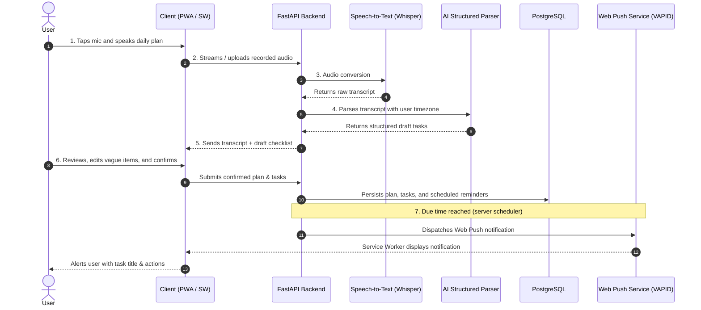
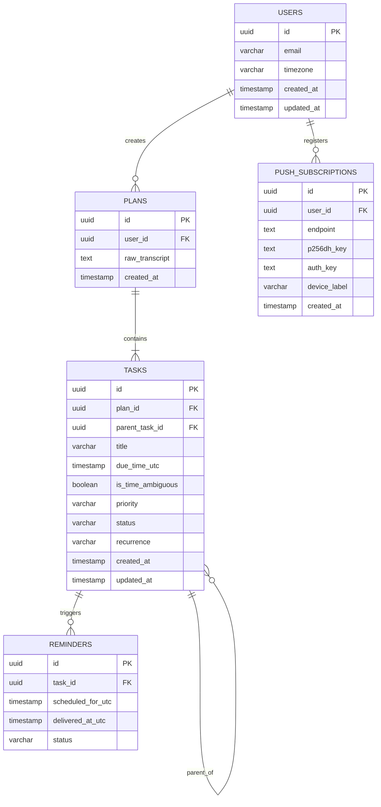

# 📋 Voice-to-Checklist Notes App — Technical Implementation Plan

> **Author**: @Donatus  
> **Date**: October 28, 2026  
> **Status**: Ready for Implementation  
> **Target Platforms**: Progressive Web App (iOS 16.4+, Android, Desktop)

---

## 1. System Overview & Vision

**Voice-to-Checklist** is an intelligent, voice-first notes app that eliminates the friction of manual task entry. Users speak their daily plans out loud; the app transcribes their words, uses an AI extraction engine to structure tasks with due dates and priorities, and schedules server-side push notifications to nudge them at the right time.

### The 7-Step Workflow



---

## 2. Technical Stack & Component Architecture

| Layer | Component | Choice | Justification |
|---|---|---|---|
| **Frontend** | PWA Client | **Next.js (React) + Vanilla CSS** | Single codebase across platforms, fast rendering, built-in service worker and manifest support, installable without App Store review. |
| **Styling** | UI Design System | **Vanilla CSS & Design Tokens** | High-performance, tailored typography (serif headers, clean sans body), glassmorphic previews, zero CSS-in-JS runtime bloat. |
| **Client Storage** | Offline Data Cache | **IndexedDB (`idb` / Dexie)** | Local persistence of checklists for instantaneous offline reading and completed task toggling. |
| **Backend API** | Application Server | **FastAPI (Python 3.11+)** | High-throughput asynchronous endpoints, native Pydantic v2 validation, seamless integration with AI libraries. |
| **Database** | Relational Database | **PostgreSQL 16** | Robust relational integrity, UTC timestamp precision, JSONB support for Web Push subscription keys. |
| **Scheduler** | Reminder Dispatcher | **APScheduler / Celery Beat** | Periodic polling (every 30–60s) of pending reminders due $\le$ `now()`. |
| **Push Delivery** | Push Notification Service | **Web Push API (pywebpush)** | Standard RFC 8291/8292 encrypted Web Push using VAPID keys, compatible with Chrome, Edge, Safari (iOS 16.4+). |
| **Speech-to-Text** | Transcription Engine | **OpenAI Whisper API / Hosted STT** | Fast, accurate transcription with language normalization; can migrate to self-hosted Whisper later. |
| **AI Parsing** | Structured Extractor | **Gemini Flash / OpenAI GPT-4o-mini** | Low latency, strict JSON Schema mode adherence, accurate temporal reasoning. |

---

## 3. Data Model & Database Schema

All timestamps are stored in **UTC**. The user's IANA timezone (e.g., `Europe/London`, `America/New_York`) is stored to compute relative dates (such as *"tomorrow at 9am"* or *"this evening"*) accurately.



### PostgreSQL DDL Schema

```sql
CREATE EXTENSION IF NOT EXISTS "uuid-ossp";

-- Users Table
CREATE TABLE users (
    id UUID PRIMARY KEY DEFAULT uuid_generate_v4(),
    email VARCHAR(255) UNIQUE,
    timezone VARCHAR(64) NOT NULL DEFAULT 'UTC',
    created_at TIMESTAMPTZ NOT NULL DEFAULT NOW(),
    updated_at TIMESTAMPTZ NOT NULL DEFAULT NOW()
);

-- Spoken Plans Table
CREATE TABLE plans (
    id UUID PRIMARY KEY DEFAULT uuid_generate_v4(),
    user_id UUID NOT NULL REFERENCES users(id) ON DELETE CASCADE,
    raw_transcript TEXT NOT NULL,
    created_at TIMESTAMPTZ NOT NULL DEFAULT NOW()
);

-- Tasks Table
CREATE TABLE tasks (
    id UUID PRIMARY KEY DEFAULT uuid_generate_v4(),
    plan_id UUID REFERENCES plans(id) ON DELETE SET NULL,
    parent_task_id UUID REFERENCES tasks(id) ON DELETE CASCADE,
    user_id UUID NOT NULL REFERENCES users(id) ON DELETE CASCADE,
    title VARCHAR(500) NOT NULL,
    due_time_utc TIMESTAMPTZ,
    is_time_ambiguous BOOLEAN NOT NULL DEFAULT FALSE,
    priority VARCHAR(20) NOT NULL DEFAULT 'normal', -- 'low', 'normal', 'high'
    status VARCHAR(20) NOT NULL DEFAULT 'open',     -- 'open', 'done', 'snoozed'
    recurrence VARCHAR(50) DEFAULT 'none',          -- 'none', 'daily', 'weekly'
    created_at TIMESTAMPTZ NOT NULL DEFAULT NOW(),
    updated_at TIMESTAMPTZ NOT NULL DEFAULT NOW()
);

-- Push Subscriptions Table
CREATE TABLE push_subscriptions (
    id UUID PRIMARY KEY DEFAULT uuid_generate_v4(),
    user_id UUID NOT NULL REFERENCES users(id) ON DELETE CASCADE,
    endpoint TEXT NOT NULL UNIQUE,
    p256dh_key TEXT NOT NULL,
    auth_key TEXT NOT NULL,
    device_label VARCHAR(100),
    created_at TIMESTAMPTZ NOT NULL DEFAULT NOW()
);

-- Reminders Table
CREATE TABLE reminders (
    id UUID PRIMARY KEY DEFAULT uuid_generate_v4(),
    task_id UUID NOT NULL REFERENCES tasks(id) ON DELETE CASCADE,
    scheduled_for_utc TIMESTAMPTZ NOT NULL,
    delivered_at_utc TIMESTAMPTZ,
    status VARCHAR(20) NOT NULL DEFAULT 'pending', -- 'pending', 'sent', 'failed', 'cancelled'
    retry_count INT NOT NULL DEFAULT 0,
    created_at TIMESTAMPTZ NOT NULL DEFAULT NOW()
);

CREATE INDEX idx_reminders_pending_due ON reminders (scheduled_for_utc, status);
CREATE INDEX idx_tasks_user_status ON tasks (user_id, status);
```

---

## 4. API Endpoints Specification

Base URL: `/api/v1`

### 4.1 Speech-to-Text: `POST /transcribe`
- **Description**: Accepts audio file from browser `MediaRecorder` (WebM/Opus or MP4), converts to text.
- **Request**: `multipart/form-data` with `file: UploadFile`.
- **Response**:
  ```json
  {
    "transcript": "Tomorrow call Maya at ten and send the project notes before lunch.",
    "duration_seconds": 4.8
  }
  ```

### 4.2 AI Parsing: `POST /parse-plan`
- **Description**: Parses raw transcript into structured candidate tasks with temporal resolution.
- **Request**:
  ```json
  {
    "transcript": "Tomorrow call Maya at ten and send the project notes before lunch.",
    "user_timezone": "America/New_York",
    "current_time_iso": "2026-10-28T14:30:00-04:00"
  }
  ```
- **Response**:
  ```json
  {
    "tasks": [
      {
        "title": "Call Maya",
        "due_time_utc": "2026-10-29T14:00:00Z",
        "due_time_display": "Tomorrow · 10:00 AM",
        "is_time_ambiguous": false,
        "priority": "high",
        "subtasks": []
      },
      {
        "title": "Send project notes",
        "due_time_utc": "2026-10-29T16:00:00Z",
        "due_time_display": "Tomorrow · Before noon",
        "is_time_ambiguous": false,
        "priority": "normal",
        "subtasks": []
      }
    ]
  }
  ```

### 4.3 Save Plan & Tasks: `POST /plans`
- **Description**: Saves the user-confirmed draft checklist, creates database records, and schedules reminders.
- **Request**:
  ```json
  {
    "user_id": "8b9826a7-05c7-43cf-a0e2-6323cce8c5a2",
    "transcript": "Tomorrow call Maya at ten and send the project notes before lunch.",
    "tasks": [
      {
        "title": "Call Maya",
        "due_time_utc": "2026-10-29T14:00:00Z",
        "priority": "high"
      },
      {
        "title": "Send project notes",
        "due_time_utc": "2026-10-29T16:00:00Z",
        "priority": "normal"
      }
    ]
  }
  ```
- **Response**:
  ```json
  {
    "plan_id": "c1f73b64-2db6-4e58-947b-1cb2bcf0a28f",
    "tasks_created": 2,
    "reminders_scheduled": 2
  }
  ```

### 4.4 Task Query & Mutation: `GET /tasks` & `PATCH /tasks/{id}`
- **`GET /tasks?status=open`**: Returns all open tasks for the user.
- **`PATCH /tasks/{id}`**: Updates task status or snoozes reminder:
  ```json
  {
    "status": "done" // or "snoozed", with "snooze_minutes": 30
  }
  ```

### 4.5 Push Registration: `POST /push/subscribe`
- **Description**: Stores browser push subscription parameters.
- **Request**:
  ```json
  {
    "user_id": "8b9826a7-05c7-43cf-a0e2-6323cce8c5a2",
    "endpoint": "https://fcm.googleapis.com/fcm/send/...",
    "keys": {
      "p256dh": "BNcR...",
      "auth": "tBH8..."
    },
    "device_label": "iPhone 15 Safari PWA"
  }
  ```

---

## 5. PWA & Web Push Notification Deep Dive

### 5.1 Platform Constraints & Support
1. **Android**: Fully supported in background via Chrome, Firefox, Edge, and Samsung Internet.
2. **Desktop**: Fully supported across Chrome, Safari (macOS Ventura+), Edge, Firefox.
3. **iOS (16.4+)**:
   - **Requirement 1**: The user **must** add the website to their Home Screen (*Share $\rightarrow$ Add to Home Screen*).
   - **Requirement 2**: Permission prompt **must** be triggered by an explicit user gesture (e.g., tapping "Enable Reminders").
   - **Requirement 3**: Every push received must show a visible user notification banner.

### 5.2 Service Worker Implementation (`public/sw.js`)

```javascript
// Listen for Web Push notification payload
self.addEventListener('push', function (event) {
  if (!event.data) return;
  const data = event.data.json();

  const options = {
    body: data.body || 'A scheduled task is due now.',
    icon: '/icons/icon-192.png',
    badge: '/icons/badge-72.png',
    data: {
      url: data.url || '/',
      taskId: data.taskId
    },
    actions: [
      { action: 'done', title: 'Mark Done' },
      { action: 'snooze', title: 'Snooze 15m' }
    ]
  };

  event.waitUntil(self.registration.showNotification(data.title, options));
});

// Handle notification click and action buttons
self.addEventListener('notificationclick', function (event) {
  event.notification.close();

  if (event.action === 'done') {
    event.waitUntil(
      fetch(`/api/v1/tasks/${event.notification.data.taskId}`, {
        method: 'PATCH',
        headers: { 'Content-Type': 'application/json' },
        body: JSON.stringify({ status: 'done' })
      })
    );
  } else if (event.action === 'snooze') {
    event.waitUntil(
      fetch(`/api/v1/tasks/${event.notification.data.taskId}`, {
        method: 'PATCH',
        headers: { 'Content-Type': 'application/json' },
        body: JSON.stringify({ status: 'snoozed', snooze_minutes: 15 })
      })
    );
  } else {
    event.waitUntil(clients.openWindow(event.notification.data.url));
  }
});
```

---

## 6. AI Structured Extraction Specification

### Prompt Engineering & Extraction Guardrails
To prevent hallucinations and guarantee valid task items, the backend invokes the LLM using **Structured JSON Outputs** (JSON Schema mode).

#### System Instructions
```text
You are an expert executive planning assistant. Convert spoken voice transcripts into structured to-do items.

Rules:
1. Extract distinct actionable tasks.
2. Resolve relative dates/times using the provided Current Date/Time and User Timezone.
3. If a time is vague or ambiguous (e.g. "sometime later", "in the afternoon", "soon"):
   - Set "due_time_utc" to null
   - Set "is_time_ambiguous" to true
4. Extract priorities: "high" for urgent/crucial tasks, "low" for trivial items, otherwise "normal".
5. Never invent tasks that were not spoken.
6. Return only valid JSON conforming to the schema.
```

#### JSON Output Schema
```json
{
  "type": "object",
  "properties": {
    "tasks": {
      "type": "array",
      "items": {
        "type": "object",
        "properties": {
          "title": { "type": "string" },
          "due_time_utc": { "type": ["string", "null"], "format": "date-time" },
          "is_time_ambiguous": { "type": "boolean" },
          "priority": { "type": "string", "enum": ["low", "normal", "high"] },
          "subtasks": { "type": "array", "items": { "type": "string" } }
        },
        "required": ["title", "due_time_utc", "is_time_ambiguous", "priority"]
      }
    }
  },
  "required": ["tasks"]
}
```

---

## 7. Phased Implementation Roadmap

```
┌─────────────────┐       ┌─────────────────┐       ┌─────────────────┐       ┌─────────────────┐
│     Phase 0     │ ───>  │     Phase 1     │ ───>  │     Phase 2     │ ───>  │     Phase 3     │
│   Setup Shell   │       │   Thin Slice    │       │     MVP App     │       │    V2 Polish    │
└─────────────────┘       └─────────────────┘       └─────────────────┘       └─────────────────┘
```

### Phase 0: Setup Shell
- [ ] Initialize repository structure with Next.js frontend and FastAPI backend.
- [ ] Set up PostgreSQL database with migration framework (Alembic).
- [ ] Configure `manifest.json`, Service Worker registration, and PWA icons.
- [ ] Verify installability on iOS Safari and Android Chrome.

### Phase 1: Thin Slice (Proving Core Value End-to-End)
- [ ] Implement browser microphone recording (`MediaRecorder` API) with volume meter.
- [ ] Wire audio upload to `/api/v1/transcribe` via Whisper API.
- [ ] Wire transcript to `/api/v1/parse-plan` with LLM task extraction.
- [ ] Add basic client-side Web Push subscription and send **1 verified test notification** to a mobile device.

### Phase 2: Complete MVP
- [ ] Build interactive **Review & Edit Screen**:
  - Edit task titles.
  - Quick-pick missing times for ambiguous tasks.
  - Delete or add items before confirming.
- [ ] Server-side background scheduler for reminder dispatching.
- [ ] Offline storage with IndexedDB (view and toggle tasks without internet).
- [ ] iOS "Add to Home Screen" onboarding visual walkthrough.
- [ ] Internal testing round with daily usage for 1 week.

### Phase 3: Version 2 Features
- [ ] "Done" and "Snooze" action buttons directly in notifications.
- [ ] Morning Briefing daily digest push (e.g., 8:00 AM summary of today's schedule).
- [ ] Smart recurring nudges for overdue high-priority tasks.
- [ ] Voice checklist mutations (*"Mark groceries done"*, *"Reschedule meeting to Friday"*).
- [ ] Multi-device user accounts and cloud synchronization.

### Phase 4: Production Hardening
- [ ] Security & Privacy: Automatic audio stream deletion after transcription.
- [ ] Rate limits and API quota guards per user.
- [ ] Push delivery telemetry and failure monitoring.

---

## 8. Risks, Mitigations & Failure Modes

| Risk / Challenge | Technical Impact | Engineering Mitigation |
|---|---|---|
| **iOS PWA Push Prerequisites** | Safari users who don't install to Home Screen cannot receive notifications. | Build an interactive visual onboarding modal detected via `window.navigator.standalone`. Guide users to *Share $\rightarrow$ Add to Home Screen*. Fall back to a Capacitor native wrapper only if needed. |
| **Unreliable Client Background Timers** | Mobile browsers sleep background tabs, killing `setTimeout` alerts. | **Strict Server-Side Scheduling**: Store all reminders in PostgreSQL with UTC dispatch times and fire them via server Web Push. |
| **Speech Recognition Hallucinations** | Accents or background noise cause inaccurate task parsing. | Transcripts are displayed immediately in real-time. A mandatory **Review & Confirm step** is required before tasks are persisted. |
| **Ambiguous Time References** | Phrases like *"do it later"* cause arbitrary reminder times. | AI prompt marks `is_time_ambiguous: true` with `due_time_utc: null`. The UI highlights these items for quick one-tap time selection. |
| **Audio Privacy & Compliance** | Users are wary of voice recordings stored on servers. | Backend deletes uploaded audio buffers immediately once transcription finishes. Zero audio files stored on disk. |
| **Push Subscription Expiration** | Endpoints become invalid when browsers refresh tokens (HTTP 410 Gone). | Scheduler catches 410 Gone errors and automatically deactivates expired subscription records in PostgreSQL. |

---

## 9. Success Metrics

1. **Zero-Edit Acceptance Rate**: $>70\%$ of generated checklist drafts confirmed without edits.
2. **On-Time Push Delivery**: $>95\%$ of scheduled reminders delivered within 60 seconds of due time.
3. **iOS Onboarding Conversion**: $>60\%$ of iOS visitors successfully completing "Add to Home Screen".
4. **Action Completion Rate**: $>50\%$ of tasks checked off directly following a reminder prompt.
