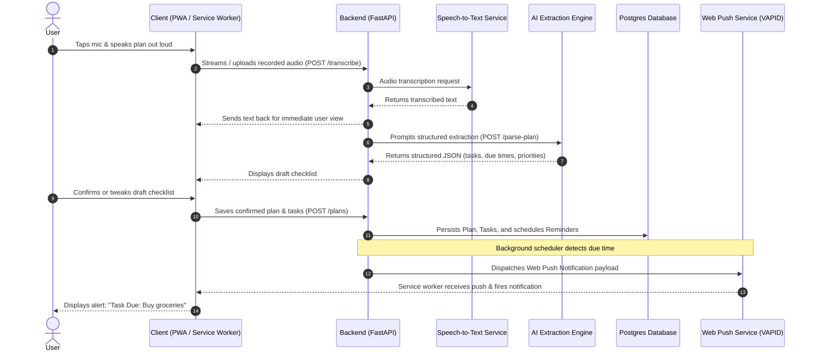
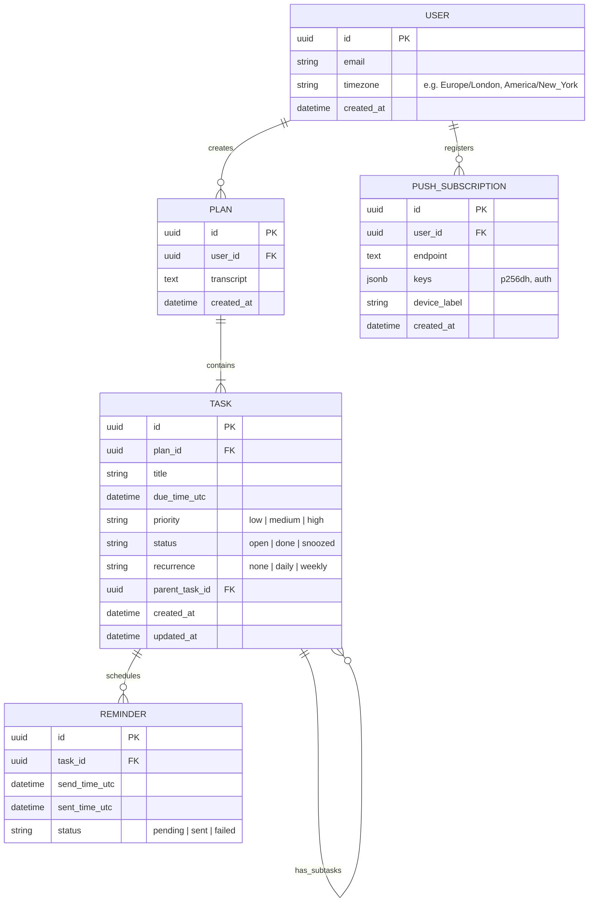

# 🎙️ Voice-to-Checklist Notes App

> **"Say your day, get your checklist, get nudged at the right time."**

An intelligent, voice-first Progressive Web App (PWA) that converts spoken plans into actionable, scheduled checklists with push notification reminders.

## Start Here

The first deliverable is a responsive landing page with a practical MVP starter checklist. Open `index.html` directly in a browser to preview it; the checklist is a visual planning aid, and its checkbox state is not saved. This static page does not record audio or send reminders.

Build the first useful slice in this order:

- [ ] Create the installable PWA shell and explain Home Screen installation, especially for iPhone push support.
- [ ] Capture one spoken note and show its transcript for correction.
- [ ] Parse titles, due times, priorities, and subtasks; leave ambiguous times unset.
- [ ] Let the user review and confirm the draft before saving it.
- [ ] Store due times in UTC with the user’s timezone and schedule reminders server-side.
- [ ] Deliver and verify a test push on Android and an iPhone with the PWA installed.

---

## 📌 Executive Summary

Typing out plans and to-do lists on mobile devices is slow, high-friction, and prone to abandonment. Most checklist apps also fail because they rely on the user remembering to open them. 

**Voice-to-Checklist Notes App** solves this problem by aligning with natural human habits:
1. **Speaking replaces typing**: Capture thoughts and daily schedules effortlessly out loud.
2. **AI replaces manual formatting**: Natural language processing extracts structured tasks, due dates, times, and priorities automatically.
3. **Push reminders replace checking**: Server-scheduled web push notifications proactively prompt the user right when tasks are due.
4. **Single codebase via PWA**: Built as an installable Progressive Web App, eliminating separate native apps while offering app-like home screen installation on iOS, Android, and Desktop.

---

## 🎯 Target Audience & Core Problem

### Who It Is For
- **Busy thinkers and planners** (students, managers, freelancers, founders, parents) who organize their day out loud.
- **People who write lists and forget them** without timely nudges.
- **Users experiencing mobile typing fatigue** who prefer voice input over clumsy touch-screen keyboards.

### Core Value Proposition
| Pain Point | How We Solve It |
|---|---|
| Typing lists on mobile is tedious | Speak naturally; audio is transcribed in real-time |
| Organizing tasks and calendar slots takes effort | AI extracts tasks, due dates (UTC), subtasks, and priorities |
| Static to-do lists are ignored | Server-driven web push reminders ping you at exact task times |
| Native apps add platform overhead | One installable PWA for iOS (16.4+), Android, and Desktop |

---

## 🚀 Product Features

### Phase 1: MVP (Minimum Viable Product)
- [x] **Voice Capture**: One-tap recording with instant microphone feedback.
- [x] **Live / Near-Realtime Transcription**: Immediate visual confirmation of recognized speech.
- [x] **AI Plan-to-Checklist Extraction**: Strict JSON structured output parsing task titles, due times (UTC-converted), and priorities.
- [x] **Review & Confirmation Step**: Human-in-the-loop validation to correct transcript or timing errors before tasks are saved.
- [x] **Timed Web Push Reminders**: Scheduled notifications delivered to the user's device when tasks are due.
- [x] **Offline Checklist**: Read and toggle completed tasks without active network connectivity.
- [x] **Install Onboarding**: Guidance explaining "Add to Home Screen" (required for iOS push notifications).

### Phase 2: Version 2 & Beyond
- **Actionable Notifications**: "Done" and "Snooze" actions directly inside push notification banners.
- **Morning Briefing**: Daily push alert summarizing today’s agenda and pending tasks.
- **Smart Nudges**: Repeated, backoff reminders for critical overdue tasks.
- **Voice List Commands**: In-app voice mutations (e.g., *"Move groceries to Friday"*, *"Mark budget report done"*).
- **Recurring Tasks**: Daily, weekly, or custom recurring intervals.
- **Multi-Device Accounts & Sync**: Cross-device syncing with user accounts.
- **Native Wrapper Fallback**: Capacitor/React Native wrapper if iOS PWA background constraints require deeper native integration.

---

## 🔄 How It Works (7-Step Flow)



---

## 🛠️ System Architecture & Technology Stack

### Architecture Overview

```
┌────────────────────────────────────────────────────────┐
│                   Frontend (PWA)                       │
│  - Next.js (React) / Installable Manifest              │
│  - Service Worker (Caching, Push Notifications)        │
│  - MediaRecorder API & Audio Streaming                 │
│  - Local offline storage (IndexedDB / CacheStorage)    │
└───────────────────────────┬────────────────────────────┘
                            │ HTTPS / WSS
┌───────────────────────────▼────────────────────────────┐
│                  Backend API Gateway                   │
│  - FastAPI (Python)                                    │
│  - User & Push Subscription Management                 │
│  - Task & Plan CRUD Operations                         │
│  - Background Scheduler (APScheduler / Celery / ARQ)   │
└─────────────┬──────────────────────────┬───────────────┘
              │                          │
              ▼                          ▼
┌─────────────────────────┐   ┌──────────────────────────┐
│   Speech-to-Text (STT)  │   │     AI Task Parsing      │
│  - Whisper / Hosted API │   │  - Structured LLM output │
│  - Instant transcript   │   │  - Timezone to UTC normal│
└─────────────────────────┘   └──────────────────────────┘
              │                          │
              └──────────────┬───────────┘
                             ▼
┌────────────────────────────────────────────────────────┐
│                   PostgreSQL Database                  │
│  - Users, Plans, Tasks, Reminders, PushSubscriptions   │
└────────────────────────────────────────────────────────┘
```

### Technology Matrix

| Layer | Technology | Rationale |
|---|---|---|
| **Frontend** | Next.js / Vanilla PWA | Fast SSR/SSG, rich ecosystem, native service worker support, responsive design |
| **Styling** | Vanilla CSS / CSS Modules | High-performance, tailored modern glassmorphic UI, zero runtime bloat |
| **Backend API** | FastAPI (Python 3.11+) | Async performance, native type safety (Pydantic), straightforward AI library integrations |
| **Database** | PostgreSQL | Robust relational structure for users, tasks, timezone math, and scheduled jobs |
| **Push Notifications** | Web Push API (VAPID / pywebpush) | Standardized web push notifications compatible across Chrome, Android, Edge, Safari |
| **Speech-to-Text** | Hosted Whisper API / AssemblyAI | Low-latency audio transcription; can be migrated to self-hosted Whisper later |
| **AI Parsing** | Gemini 2.5/3.8 Flash / Claude 3.5 Sonnet / OpenAI | Fast, high-accuracy structured JSON generation with function/schema enforcement |

---

## 🔔 Notifications: PWA Capabilities & Constraints

Web push notifications behave differently across platforms:

| Platform | Push Supported? | Requirements & Constraints |
|---|---|---|
| **Android** (Chrome, Edge, Firefox, Samsung) | ✅ Yes | Works even when the browser and app are closed. |
| **Desktop** (Chrome, Edge, Firefox, Safari) | ✅ Yes | Standard Service Worker push mechanism. |
| **iOS / iPadOS** (iOS 16.4+) | ⚠️ Yes (with conditions) | 1. User **must** add app to Home Screen via Safari (*Share -> Add to Home Screen*).<br>2. Push permission **must** be triggered from a direct user tap.<br>3. Notification payload must show a visible alert. |

> [!IMPORTANT]
> **Server-Side Scheduling is Mandatory**: Browsers do not support reliable offline background timers. All task reminder times are stored in UTC on the server and fired via Web Push at the exact moment they become due.

---

## 🗄️ Data Model



---

## 🔌 API Endpoints Specification

| Method | Endpoint | Description | Sample Request / Response |
|---|---|---|---|
| `POST` | `/api/transcribe` | Uploads recorded audio file (e.g. `audio/webm`), returns transcript text. | **Req**: `multipart/form-data (audio: file)`<br>**Res**: `{"transcript": "Tomorrow 9am call client"}` |
| `POST` | `/api/parse-plan` | Sends raw transcript text + user timezone, returns structured candidate tasks. | **Req**: `{"transcript": "...", "timezone": "America/New_York"}`<br>**Res**: `{"tasks": [{"title": "Call client", "due_time_utc": "...", "priority": "high"}]}` |
| `POST` | `/api/plans` | Confirms draft checklist, persists plan and its tasks, schedules reminders. | **Req**: `{"transcript": "...", "tasks": [...]}`<br>**Res**: `{"plan_id": "...", "tasks_created": 3}` |
| `GET` | `/api/tasks` | Retrieves user's active and completed checklists. | **Query**: `?status=open`<br>**Res**: `[{"id": "...", "title": "...", "due_time_utc": "..."}]` |
| `PATCH` | `/api/tasks/{id}` | Updates task properties, marks task as done, or snoozes reminder. | **Req**: `{"status": "done"}` or `{"snooze_minutes": 30}`<br>**Res**: `{"status": "updated"}` |
| `POST` | `/api/push/subscribe` | Registers browser Web Push subscription (`endpoint`, `keys`). | **Req**: `{"endpoint": "https://...", "keys": {"p256dh": "...", "auth": "..."}}`<br>**Res**: `{"status": "subscribed"}` |

---

## 🗺️ Project Roadmap & Phases

```
┌──────────────┐     ┌──────────────┐     ┌──────────────┐     ┌──────────────┐
│   Phase 0    │ ──> │   Phase 1    │ ──> │   Phase 2    │ ──> │   Phase 3    │
│  Setup Shell │     │  Thin Slice  │     │   Full MVP   │     │  V2 & Polish │
└──────────────┘     └──────────────┘     └──────────────┘     └──────────────┘
```

### Phase 0: Setup Shell
- Initialize installable PWA skeleton (Next.js) with manifest and service worker.
- Set up FastAPI backend skeleton with Postgres database and migrations.
- Verify Home Screen installation on both Android and iOS devices.

### Phase 1: Thin Slice
- Mic audio recording & streaming in PWA.
- Minimal speech-to-text integration + simple AI parser.
- End-to-end test: spoken voice note -> checklist entry created -> 1 scheduled test push reminder delivered to phone.

### Phase 2: Full MVP
- Polished Review & Edit screen with human confirmation workflow.
- Robust server-side reminder scheduler with timezone conversion.
- Offline storage and sync reconciliation (IndexedDB).
- iOS "Add to Home Screen" onboarding modal.
- Daily usage dogfooding with internal beta testers.

### Phase 3: Version 2 Enhancements
- Interactive push notifications (Done & Snooze).
- Morning Briefing notification.
- Voice commands for checklist updates.
- Recurring tasks and multi-device account sync.

### Phase 4: Hardening & Launch
- Privacy safeguards (immediate audio deletion after transcription).
- Rate limits, quota guards, and cost monitoring.
- Analytics on reminder delivery reliability and task completion rates.

---

## ⚠️ Key Risks & Mitigations

| Risk | Why It Matters | Mitigation Strategy |
|---|---|---|
| **iOS PWA Push Requirements** | Users who don’t install to Home Screen cannot receive push notifications. | Implement a clear visual onboarding modal explaining "Install to get reminders"; fallback to Capacitor wrapper if required. |
| **Unreliable Device-Side Timers** | Background timers get suspended by mobile operating systems. | Reminders are scheduled and dispatched strictly server-side using Web Push. |
| **Speech Recognition Errors** | Misheard audio produces garbled tasks. | Display recognized transcript immediately with a mandatory Review & Edit screen before saving. |
| **Ambiguous Time Parsing** | Sayings like "do this later" cause inaccurate alarms. | When time is vague, leave the date/time empty and highlight it in the review UI for explicit user selection. |
| **Audio Privacy Concerns** | Users are sensitive about voice recordings. | Delete audio files immediately after speech-to-text processing; clearly communicate zero audio storage in UI. |
| **Transcription & LLM API Costs** | Token and STT costs scale with voice volume. | Use fast, cost-effective models (e.g. Flash models), cache repeated patterns, and offer self-hosted Whisper later. |

---

## 📊 Success Metrics

- **Zero-Edit Acceptance Rate**: % of AI-generated checklists saved without manual edits.
- **On-Time Push Delivery**: % of scheduled reminders reaching devices within 60 seconds of due time.
- **iOS Onboarding Conversion**: % of Safari iOS users who successfully install the PWA to their Home Screen.
- **Action Completion Rate**: % of tasks checked off within 3 hours of receiving a reminder.

---

## 📝 Authors & Project Credits

- **Project Lead**: @Donatus
- **Document Date**: October 28, 2026
